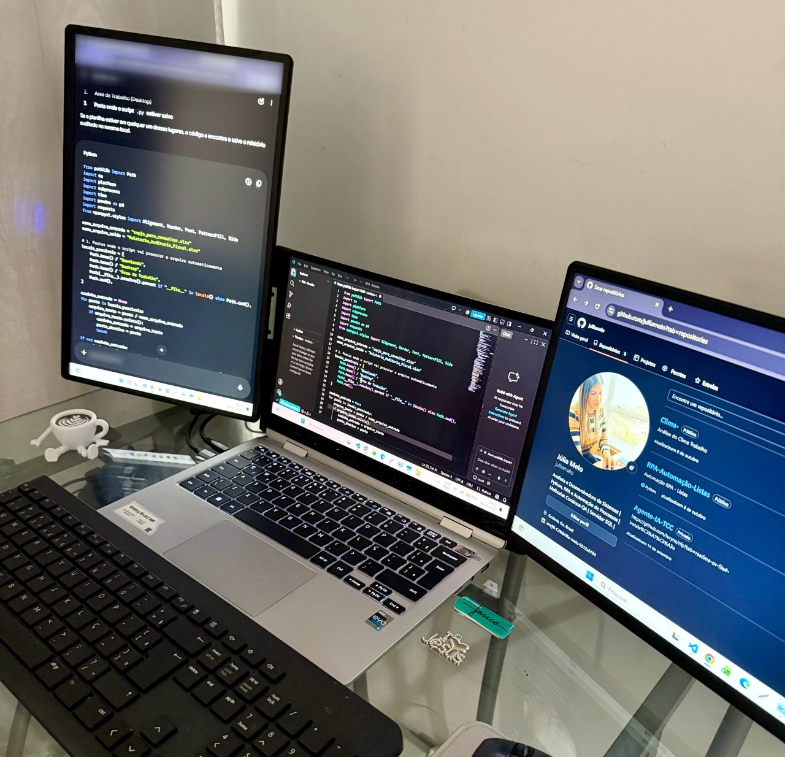
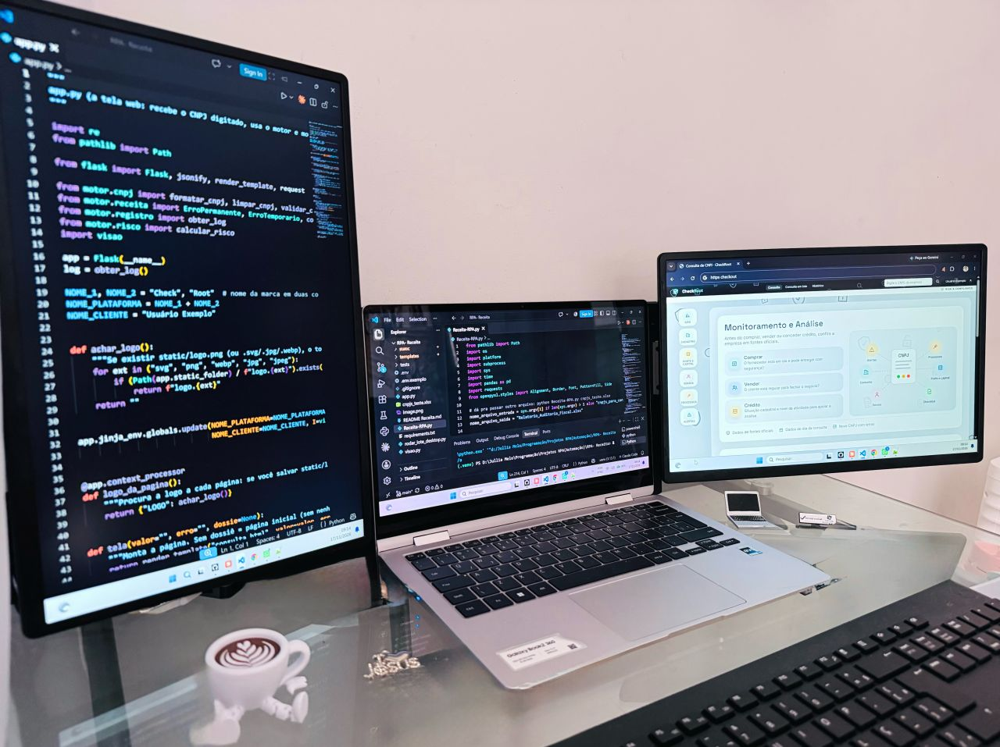

# Sobre

**Desenvolvedora Python Júnior · RPA · Automação de Processos · Análise e Desenvolvimento de Sistemas**

Atuo em Tecnologia da Informação desde 2014. Hoje meu foco é desenvolvimento de sistemas e automação de processos. Sigo em desenvolvimento profissional, construindo projetos e aprendendo na prática. Gosto de pegar uma tarefa repetitiva, entender onde ela trava e transformar em algo que roda sozinho, com análise crítica e detalhada para evitar retrabalho e garantir uma execução melhor.

Desenvolvo robôs RPA e aplicações em Python, com integração entre sistemas e consumo de APIs, unindo análise de sistemas, regras de negócio e dados para resolver problemas reais das empresas.

🎓 Graduação em Análise e Desenvolvimento de Sistemas · Pós-graduação em Processamento de Linguagem Natural (PLN), AKCIT/UFG

## Competências

- **RPA e automação de processos:** robôs com Python, Selenium e Playwright (web) e PyAutoGUI (desktop), n8n, manipulação de arquivos e planilhas com pandas, integração entre sistemas
- **Python:** aplicações, estrutura de projetos, versionamento com Git e GitHub
- **Desenvolvimento web:** Flask, HTML e CSS
- **Análise de sistemas:** levantamento de requisitos, regras de negócio, mapeamento de processos e melhoria contínua
- **Dados e BI:** extração e tratamento de dados (ETL com Python e Excel), SQL Server, modelagem de dados, Power BI e IBM Cognos
- **QA e testes automatizados** com pytest, para o robô entregar o mesmo resultado sempre
- **Cuidado com dados pessoais (LGPD)** e rastreabilidade: logs de tudo que o robô faz
- **Gestão e suporte de plataforma:** controle de saldos e permissões por pontos focais, liberação de acessos conforme os critérios de cada demanda e coordenação dos pontos focais
- **Infraestrutura e suporte:** sistema operacional Windows, software e hardware, Active Directory, redes, segurança da informação, controle de acessos e manutenção técnica

## Projetos

**[RPA-Automacao-Receita-Portfolio](https://github.com/julliamelo/RPA-Automacao-Receita-Portfolio)**
Começou como um robô que conferia listas de CNPJ e gerava Excel. Hoje é um projeto maior, com interface: uma plataforma web que consulta o CNPJ de uma empresa em fontes públicas e entrega um dossiê com semáforo de risco, com login e histórico por usuário.

**[RPA-Listas](https://github.com/julliamelo/RPA-Listas)**
Script em Python que pega uma lista grande de contatos e separa em um Excel por unidade, com a limpeza dos dados feita no caminho. Código aberto, com planilha de exemplo para testar.

**[Dossie-Compliance-Portfolio](https://github.com/julliamelo/Dossie-Compliance-Portfolio)**
Aplicativo desktop que reúne consultas em bases públicas e gera um dossiê de compliance em PDF.

**[Agente-IA-TCC-Chatbot-Nutricao-Portfolio](https://github.com/julliamelo/Agente-IA-TCC-Chatbot-Nutricao-Portfolio)**
Chatbot de nutrição com IA (RAG), meu TCC de pós-graduação em PLN.

**[Clima-Analise-Trabalho](https://github.com/julliamelo/Clima-Analise-Trabalho)**
Análise de dados de clima organizacional. Em construção.

> Os repositórios com `-Portfolio` no nome mostram o que cada projeto faz. O código completo desses fica em repositório privado.

## Destaque no LinkedIn

O projeto de consulta de CNPJ está em desenvolvimento e teve ótimo retorno. Confira as publicações:

| [Publicação 1: robô de automação](https://lnkd.in/p/dMwdxbUY) | [Publicação 2: automação / plataforma web](https://lnkd.in/p/ddpQVW5M) |
|---|---|
|  |  |

## Ferramentas

## Contato

Aberta a novas oportunidades como desenvolvedora RPA Júnior, desenvolvedora Python Júnior, analista de automação de processos e IA, analista de desenvolvimento de sistemas ou analista de pesquisa e desenvolvimento.

Me chama no [LinkedIn](https://www.linkedin.com/in/j%C3%BAllia-melo-5512a6194/).
